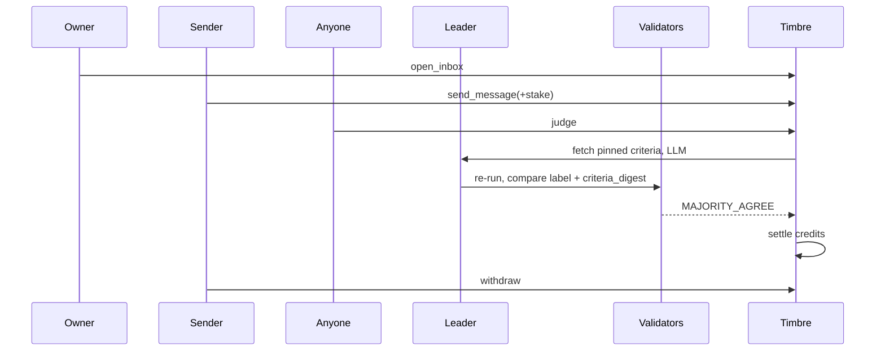
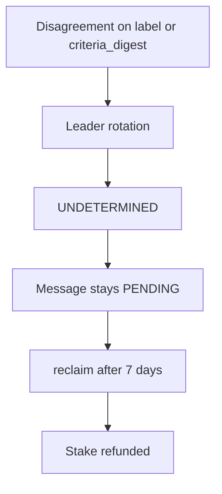

# Timbre

Timbre is a refundable attention stamp. To write to someone, the sender attaches a small stake. GenLayer validators compare the message with criteria the recipient published in advance. A serious, on-topic message is refunded. Spam, or a report that does not meet the published bar, pays the recipient.

## The problem

On 26 January 2026 Daniel Stenberg announced that the curl bug-bounty would stop on 31 January 2026. The program had paid for real vulnerabilities, then the confirmed rate fell below 5% in 2025 under a flood of low-quality reports he calls AI slop. Maintainer time went to debunking them. Source: [The end of the curl bug-bounty](https://daniel.haxx.se/blog/2026/01/26/the-end-of-the-curl-bug-bounty/).

On 25 February 2026 he listed what a reporting channel still needs. Item 12 asks for additional, customizable requirements before someone has the privilege of submitting a report (a rate limit, or time since the account was created). Source: [curl security moves again](https://daniel.haxx.se/blog/2026/02/25/curl-security-moves-again/).

Timbre is a filter at the door, not a bounty for a confirmed bug. The recipient writes the bar in prose. The sender stakes a small amount. Validators decide whether the message meets that bar. The stake comes back, or it pays the recipient for the time.

## Why GenLayer, not an oracle

"Does this message meet criteria written in prose?" is not a value a contract can compute, and it is not a fact an oracle can fetch from a URL.

The two parties want opposite answers. The recipient is paid if every message is `SPAM`. The sender is refunded if every message is `RELEVANT`. Neither of them can be the judge. The judge has to be neutral and repeatable: the validators re-run the same judgment and agree on the label.

## Verdicts and payments

The stake is credited. Nothing is transferred inside `judge`. `withdraw` is the only transfer: it sets the credit to zero, then emits the transfer. The contract keeps no fee.

An `OFF_TOPIC` split uses integer division: `owner_part = stake * 5000 // 10000`, and the sender receives `stake - owner_part`. No wei is dropped.

| Verdict | Meaning | Sender | Owner |
|---|---|---|---|
| `RELEVANT` | The message fits an accepted category and gives the specifics the criteria require. | 100% of the stake | 0 |
| `OFF_TOPIC` | Sincere and specific, but outside the accepted categories. | 50% | 50% |
| `SPAM` | Promotion or mass outreach, a vague report missing what the criteria require, an attempt to manipulate the judge, or a `text_url` the sender made unavailable (4xx, too large, or not text). | 0 | 100% |
| `UNCERTAIN` | The model cannot decide, or the criteria are ambiguous, unreadable, abusive, or missing (4xx). An unavailable `text_url` is not `UNCERTAIN`. | 100% | 0 |
| `EXPIRED` (status) | Still pending after `judge_deadline`, then `reclaim()`. | 100% | 0 |

## How a judgment runs



If the validators do not agree, the sender does not lose the stake. The network rotates the leader. If no majority forms, the transaction is `UNDETERMINED` and the contract state does not change. The message stays `PENDING`. After seven days anyone can `reclaim` it, and the stake is refunded.



## Equivalence principle

Choice: a custom validator, `run_nondet_unsafe`, that re-runs the judgment on its own and compares two fields for strict equality: (1) the `label`, and (2) the `criteria_digest`, the sha256 of the criteria text that was read. `reason` and `criteria_met` are not compared.

Why this choice:

- The decision is a closed set of four values. Strict equality on that field is the "Partial Field Matching" pattern from the docs: compare the decision, not the explanation. Reasons always differ. The decisions must match.
- Why not `prompt_comparative`: a third LLM call to ask "equivalent?" would cost more and would be looser. A validator could accept `RELEVANT` as close enough to `OFF_TOPIC`, and that gap is 50% of the stake. The helpers are outgrown quickly.
- Why not `strict_eq` on the whole output: `reason` always varies, so consensus would be impossible.
- Why the digest as well: it proves that the leader and the validators read the same criteria file. That file is immutable (a pinned commit), so the digest is deterministic. A leader that invented criteria is rejected.
- Disagreement (`RELEVANT` on one side, `OFF_TOPIC` on the other): rejection, leader rotation, and if no consensus is reached the transaction is `UNDETERMINED` with no state change. The message stays `PENDING`. `judge` can be tried again or, after seven days, `reclaim` refunds the stake. When in doubt, the sender loses nothing. That is intentional.
- Errors (the same families as GreenClaim):
  - `[EXPECTED]` / `[EXTERNAL]`: the error messages must be exactly equal.
  - `[TRANSIENT]`: the two sides agree when both are transient.
  - `[LLM_ERROR]`: disagreement, which forces rotation.
  - Inside `judge`, an `[EXTERNAL]` failure on the criteria (4xx, too large, not text) is settled as `UNCERTAIN`, and the stake is refunded. The same failure on `text_url` is raised as `[EXTERNAL][SENDER] message file unavailable: …` and settled as `SPAM` (the stake goes to the owner): the sender must not be able to hide the file and get a refund. `_handle_leader_error` still requires the error message to match exactly, including for `[EXTERNAL][SENDER]`. A `[TRANSIENT]` failure (criteria or `text_url`) reverts: the message stays `PENDING` and the call can be retried.

```python
def leader_fn() -> dict:
    criteria = _fetch_pinned_text(criteria_url)          # [EXTERNAL] -> UNCERTAIN
    if text:
        body = text
    else:
        try:
            body = _fetch_pinned_text(text_url)
        except gl.vm.UserError as err:                  # [EXTERNAL] -> [EXTERNAL][SENDER] -> SPAM
            ...
    out = _call_llm(_build_prompt(criteria, body))       # {"label","criteria_met","reason"}
    out["criteria_digest"] = _sha256_hex(criteria)
    return out

def validator_fn(leaders_res) -> bool:
    if not isinstance(leaders_res, gl.vm.Return):
        return _handle_leader_error(leaders_res, leader_fn)
    mine = leader_fn()
    lead = leaders_res.calldata
    return isinstance(lead, dict) and lead.get("label") == mine["label"] \
        and lead.get("criteria_digest") == mine["criteria_digest"]
```

## API

Amounts are wei integers. The CLI converts a decimal GEN amount with `BigInt` before it calls.

### Timbre

| Method | Kind | Who | What it does |
|---|---|---|---|
| `open_inbox(name, criteria_url, min_stake, max_stake) -> int` | write | anyone, and that caller becomes `owner` | Pinned criteria URL. `1 <= min_stake <= max_stake <= 100 * min_stake`. No web call; the file is read only at judgment. |
| `update_criteria(inbox_id, criteria_url)` | write | owner | New pinned URL. Pending messages keep the URL snapshotted at send time. |
| `set_open(inbox_id, open)` | write | owner | Closes or reopens the inbox. Pending messages can still be judged. |
| `send_message(inbox_id, text, text_url) -> int` | write, payable | anyone except the owner | `msg.value` is the stake. Exactly one of `text` or `text_url`. See the send checks below. |
| `judge(message_id) -> str` | write | anyone | `PENDING` and `now <= judge_deadline`. Returns the verdict. Credits only; no transfer. |
| `reclaim(message_id) -> str` | write | anyone | `PENDING` and past the deadline. Status becomes `EXPIRED`. The stake is credited back. |
| `tip(message_id)` | write, payable | owner | The message must already be judged. The value is credited to the sender. |
| `withdraw() -> int` | write | anyone with a credit | Reads the credit, sets it to zero, then `emit_transfer`. Reverts on zero. |
| `preview_send(inbox_id, sender_hex, text, text_url, stake) -> {ok, error}` | view | anyone | The same checks as `send_message`, with no value and no write. |
| `get_inbox(id)` | view | anyone | Inbox record, including owner, bounds, and per-verdict counters. |
| `list_inboxes(offset, limit)` | view | anyone | `limit` from 1 to 50. |
| `get_message(id)` | view | anyone | Full message, including `status`, `verdict`, `sender`, and `criteria_digest`. |
| `list_messages(inbox_id, offset, limit)` | view | anyone | `limit` from 1 to 50. |
| `is_relevant(message_id) -> bool` | view | anyone | True only for a judged `RELEVANT` message. |
| `get_credit(addr_hex) -> int` | view | anyone | Credit still waiting for `withdraw`. |
| `stats() -> {inboxes, messages, pending_total, total_credits}` | view | anyone | Contract-wide counters. |
| `inbox_stats(id)` | view | anyone | Per-verdict counts, `earned`, `refunded`, and `spam_rate_bps` over decided messages. |

`send_message` checks, kept small because a refused payable on Studionet keeps the value:

- the inbox exists and is open;
- the sender is not the owner;
- `min_stake <= value <= max_stake`;
- exactly one of `text` and `text_url` is set;
- `text` is 20 to 2000 characters after whitespace is normalized, and contains no control character;
- `text_url`, when used, is pinned to a commit;
- fewer than 3 pending messages from this sender in this inbox, and fewer than 50 pending in the inbox.

### BountyIntake

No LLM. It pays only for a Timbre message that is already `JUDGED` and `RELEVANT` in one inbox.

| Method | Kind | Who | What it does |
|---|---|---|---|
| `__init__(timbre, inbox_id)` | constructor | deployer, who becomes `owner` | Stores the Timbre address and the inbox it watches. |
| `fund() -> int` | write, payable | owner | Adds `msg.value` to `pool`. The value must be greater than 0. |
| `forward(message_id) -> int` | write | anyone | Reads `get_message` on Timbre. Accepts only `JUDGED` / `RELEVANT` from its inbox, and only once. Creates a `QUEUED` entry. |
| `award(entry_id, amount)` | write | owner | `amount` must be greater than 0 and no larger than `pool`. Credits the sender and marks the entry `AWARDED`. |
| `withdraw() -> int` | write | anyone with a credit | Sets the credit to zero, then `emit_transfer`. |
| `get_entry(id)` | view | anyone | One entry. |
| `list_entries(offset, limit)` | view | anyone | `limit` from 1 to 50. |
| `get_credit(addr_hex) -> int` | view | anyone | Credit still waiting for `withdraw`. |
| `stats()` | view | anyone | `owner`, `timbre`, `inbox_id`, `pool`, `entries`, `total_credits`. |

## Threat model

| Threat | Mitigation | What remains |
|---|---|---|
| A greedy recipient (everything labeled `SPAM`) | Consensus judgment. No method lets the owner set a verdict. Abusive criteria settle as `UNCERTAIN`. `max_stake` caps the stake. `inbox_stats` is public. | Criteria that are harsh but still legitimate. The reader of the criteria decides whether to send. |
| A sender who manipulates the LLM | The text is neutralized and wrapped as data. Any instruction addressed to the judge is `SPAM`. Validators re-run the judgment. | Novel injections. The tests cover the usual ones. |
| A dishonest leader | Independent re-execution. Strict equality of the label and the digest. | Collusion by a majority of validators. That is outside this model. |
| Criteria changed after a message was sent | The criteria URL is snapshotted at send time, and the URL is pinned to a commit. | — |
| Message spam | A stake, plus caps on pending messages. | A rich sender can still pay to spam, and that payment goes to the recipient. |
| Stuck funds | Pull payments, `reclaim` after 7 days, and the solvency identity in the direct tests. | A refused payable on Studionet keeps its value. That is network behavior. |
| Privacy | — | Everything is public on-chain. Never put an undisclosed vulnerability here. |

## Honest limits

1. Timbre judges conformity and seriousness against published criteria. It does not judge whether a bug or a vulnerability is real.
2. Messages are public on-chain: never send an undisclosed vulnerability. Send a non-sensitive summary, or use Timbre for public channels (bugs already meant to be public, proposals, pitches, grant applications).
3. Two models can hesitate between `OFF_TOPIC` and `SPAM` on a borderline message. There is then no consensus: the message stays `PENDING` and is later refunded. That outcome is accepted.
4. A stake, even a refundable one, can deter an honest sender. Keep `min_stake` low.
5. The demo runs on Studionet only (gasless, simulated balances). There is no mainnet deployment.
6. The cross-contract call is mocked in direct-mode tests (the runner allows one contract per process) and proven live on Studionet.

## Consumer example

`BountyIntake` is a bounty queue that does not judge anything itself. `forward` reads Timbre and accepts a message only when that message is `JUDGED` and `RELEVANT` in the inbox this contract was constructed with. A second `forward` of the same message is refused, as is any other inbox, any other verdict, and anything still `PENDING` or `EXPIRED`.

`award` pays the original sender from the pool, as a credit. `withdraw` is a pull payment: the credit is cleared before the transfer. The point of the contract is to show that another contract can treat a Timbre verdict as an input.

## Tests

Direct tests run the contracts in memory. They do not need Studio, and they do not call the network. The integration test is opt-in (`TIMBRE_IT=1`) and is not part of CI.

```shell
pip install -r requirements.txt
pytest tests/direct -v
npm ci
npm test
```

Output of `pytest tests/direct -v` on this machine, 28 October 2026 (34 passed):

```text
INFO: File `gltest.config.yaml` found in the current directory, using it
INFO: Clearing artifacts directory: artifacts
INFO: Using the following configuration:
INFO:   RPC URL: http://127.0.0.1:4000/api
INFO:   Selected Network: localnet
INFO:   Available networks: ['localnet', 'studionet']
INFO:   Selected chain type: localnet
INFO:   Available chains: localnet, studionet, testnet_asimov, testnet_bradbury
INFO:   Contracts directory: contracts
INFO:   Artifacts directory: artifacts
INFO:   Environment: .env
INFO:   Default wait interval: 3000 ms
INFO:   Default wait retries: 50
INFO:   Leader only mode: False
============================= test session starts =============================
platform win32 -- Python 3.12.10, pytest-9.1.1, pluggy-1.7.0 -- C:\Users\Al\Desktop\Projets\GenLayer\timbre\.venv\Scripts\python.exe
cachedir: .pytest_cache
rootdir: C:\Users\Al\Desktop\Projets\GenLayer\timbre
configfile: pyproject.toml
plugins: genlayer-test-0.29.2
collecting ... collected 34 items

tests/direct/test_bounty_intake.py::test_forward_accepts_a_relevant_message PASSED [  2%]
tests/direct/test_bounty_intake.py::test_forward_rejects_other_verdicts[OFF_TOPIC] PASSED [  5%]
tests/direct/test_bounty_intake.py::test_forward_rejects_other_verdicts[SPAM] PASSED [  8%]
tests/direct/test_bounty_intake.py::test_forward_rejects_other_verdicts[UNCERTAIN] PASSED [ 11%]
tests/direct/test_bounty_intake.py::test_forward_rejects_pending_and_expired[PENDING] PASSED [ 14%]
tests/direct/test_bounty_intake.py::test_forward_rejects_pending_and_expired[EXPIRED] PASSED [ 17%]
tests/direct/test_bounty_intake.py::test_forward_rejects_another_inbox_and_duplicates PASSED [ 20%]
tests/direct/test_bounty_intake.py::test_award_respects_the_pool PASSED  [ 23%]
tests/direct/test_bounty_intake.py::test_only_the_owner_can_fund_and_award PASSED [ 26%]
tests/direct/test_bounty_intake.py::test_withdraw_clears_credit_before_transfer PASSED [ 29%]
tests/direct/test_timbre.py::test_text_url_404_pays_the_owner PASSED     [ 32%]
tests/direct/test_timbre.py::test_prompt_does_not_ask_whether_the_bug_is_real PASSED [ 35%]
tests/direct/test_timbre.py::test_open_inbox_rejects_unpinned_urls_and_incoherent_stakes PASSED [ 38%]
tests/direct/test_timbre.py::test_preview_send_matches_send_message PASSED [ 41%]
tests/direct/test_timbre.py::test_pending_caps_per_sender_and_per_inbox PASSED [ 44%]
tests/direct/test_timbre.py::test_relevant_refunds_the_sender PASSED     [ 47%]
tests/direct/test_timbre.py::test_off_topic_odd_stake_splits_without_remainder PASSED [ 50%]
tests/direct/test_timbre.py::test_spam_pays_the_owner PASSED             [ 52%]
tests/direct/test_timbre.py::test_model_uncertain_refunds_the_sender PASSED [ 55%]
tests/direct/test_timbre.py::test_criteria_missing_or_too_large_refunds_as_uncertain PASSED [ 58%]
tests/direct/test_timbre.py::test_criteria_503_and_429_stay_pending_then_succeed PASSED [ 61%]
tests/direct/test_timbre.py::test_text_url_too_large_or_not_text_is_spam PASSED [ 64%]
tests/direct/test_timbre.py::test_text_url_503_stays_pending_then_judges PASSED [ 67%]
tests/direct/test_timbre.py::test_validator_disagrees_on_label_and_digest PASSED [ 70%]
tests/direct/test_timbre.py::test_leader_error_families PASSED           [ 73%]
tests/direct/test_timbre.py::test_injection_is_neutralized_and_pays_the_owner PASSED [ 76%]
tests/direct/test_timbre.py::test_llm_off_schema_reverts_and_stays_pending PASSED [ 79%]
tests/direct/test_timbre.py::test_update_criteria_keeps_the_snapshot PASSED [ 82%]
tests/direct/test_timbre.py::test_reclaim_refunds_only_after_the_window PASSED [ 85%]
tests/direct/test_timbre.py::test_withdraw_clears_the_credit_before_the_transfer PASSED [ 88%]
tests/direct/test_timbre.py::test_tip_is_owner_only_and_only_after_judgment PASSED [ 91%]
tests/direct/test_timbre.py::test_closed_inbox_blocks_send_but_not_judgment PASSED [ 94%]
tests/direct/test_timbre.py::test_pickling_and_calldata_roundtrip PASSED [ 97%]
tests/direct/test_timbre.py::test_get_message_builds_the_forward_mock PASSED [100%]

============================= 34 passed in 1.90s ==============================
```

## Live demo

Not run yet. Fill this table from a Studionet run. The procedure, the pinned criteria URL, and the receipt rule are in [DEPLOY.md](DEPLOY.md). A row counts only when the receipt is `ACCEPTED` or `FINALIZED`, the consensus is `MAJORITY_AGREE` or `AGREE`, and execution is `FINISHED_WITH_RETURN` or `SUCCESS`. If a verdict differs from the expected column, write the label the chain returned. Do not rewrite the row.

Timbre: `<CONTRACT_ADDRESS>`

BountyIntake: `<CONTRACT_ADDRESS>`

| Step | Call | Tx | Expected verdict | Obtained verdict |
|---|---|---|---|---|
| deploy-timbre | `deploy-timbre` | `<TX_HASH>` | | |
| open | `open` tinyparse inbox, pinned `demo/INBOX.md`, 0.01 to 0.1 GEN | `<TX_HASH>` | | |
| send 0 | `send 0 demo/messages/01-good-report.md 0.01` | `<TX_HASH>` | | |
| judge 0 | `judge 0` | `<TX_HASH>` | `RELEVANT` | |
| send 1 | `send 0 demo/messages/02-ai-slop.md 0.01` | `<TX_HASH>` | | |
| judge 1 | `judge 1` | `<TX_HASH>` | `SPAM` | |
| send 2 | `send 0 demo/messages/03-spam.md 0.01` | `<TX_HASH>` | | |
| judge 2 | `judge 2` | `<TX_HASH>` | `SPAM` | |
| send 3 | `send 0 demo/messages/04-injection.md 0.01` | `<TX_HASH>` | | |
| judge 3 | `judge 3` | `<TX_HASH>` | `SPAM` | |
| send 4 | `send 0 demo/messages/05-off-topic.md 0.01` | `<TX_HASH>` | | |
| judge 4 | `judge 4` | `<TX_HASH>` | `OFF_TOPIC` | |
| withdraw A | `withdraw` as the inbox owner | `<TX_HASH>` | | |
| withdraw B | `withdraw` as the sender | `<TX_HASH>` | | |
| owner preview | `preview` of the owner messaging their own inbox; do not send value | | refused by `preview_send` | |
| deploy-intake | `deploy-intake <CONTRACT_ADDRESS> 0` | `<TX_HASH>` | | |
| fund | `fund 0.05` | `<TX_HASH>` | | |
| forward | `forward 0` | `<TX_HASH>` | accepted, message is `RELEVANT` | |
| award | `award 0 0.02` | `<TX_HASH>` | | |
| intake-withdraw | `intake-withdraw` as the sender | `<TX_HASH>` | | |
| forward spam | `forward 1` | | refused before submission | |

Studio import: `https://studio.genlayer.com/?import-contract=<CONTRACT_ADDRESS>`

Explorer: `https://explorer-studio.genlayer.com/address/<CONTRACT_ADDRESS>` and `https://explorer-studio.genlayer.com/tx/<TX_HASH>`

## Credits

This repository started from the [genlayerlabs](https://github.com/genlayerlabs) project boilerplate. That boilerplate is MIT-licensed, copyright 2024 YeagerAI. See [LICENSE](LICENSE).
